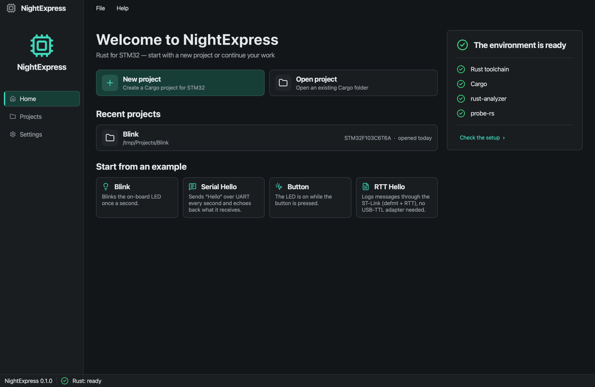
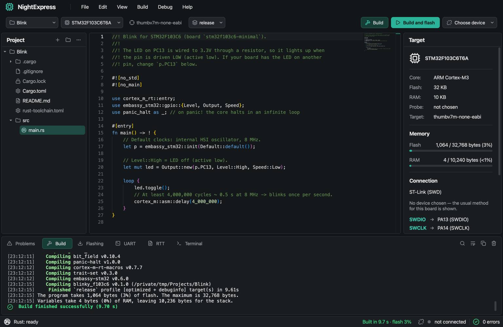

# NightExpress

A simple IDE for comfortable work with Rust on STM32: pick the board and the device, press **Build and flash**.

Status: MVP. Create a Cargo project for a supported board (from scratch or from an example), edit it, build it and flash it in one click through an ST-Link, a USB-TTL adapter (the chip's UART bootloader) or straight over USB (DFU, on the Black Pill); add sensor modules (MPU-6050, BMP180, BMP280) on I2C with their driver and wiring; see what the board prints in the UART monitor, or its defmt log through the ST-Link in the RTT tab (no UART adapter needed), and work in the built-in terminal. Light and dark themes; Ukrainian, English, Spanish, French and German interface.





## Development

### Setup

```sh
python3 -m venv .venv
.venv/bin/pip install -e ".[dev]"
.venv/bin/python scripts/fetch_monaco.py   # code editor (Monaco), ~6 MB, checked by sha512
.venv/bin/python scripts/fetch_xterm.py    # terminal tab (xterm.js), ~0.5 MB, checked by sha512
```

### Run

```sh
.venv/bin/python -m nightexpress         # the app
.venv/bin/python scripts/preview_ui.py   # the main window with fake data
```

The screenshots above come from `scripts/preview_ui.py --screenshot out --lang en --workspace /tmp/Projects`, scaled to half size.

### Checks and tests

```sh
scripts/check.sh                         # ruff + pytest + build of the reference firmware
```

## Structure (MVC)

```text
src/nightexpress/
├── app.py          # composition root: creates and connects models, views, controllers, services
├── i18n.py         # interface translations (gettext)
├── models/         # Model: entities (dataclass), state (QObject), qt_models
├── views/          # View: widgets, panels, dialogs, editor, theme; only display and intent signals
├── controllers/    # Controller: user scenarios
├── services/       # Cargo, probe-rs, dfu-util, UART bootloader, serial, RTT, terminal, files, settings
└── resources/      # board and chip catalog, templates, peripherals, themes, icons, translations,
                    # the editor (Monaco) and terminal (xterm.js) pages
reference/          # reference firmware, verified on hardware
scripts/            # setup, checks, UI preview, catalog / icon / translation updates
docs/images/        # screenshots for this README
tests/              # unit, ui (pytest-qt), hardware, drivers (cargo test of the sensor drivers)
```

The dependency rules between the layers are checked by `tests/unit/test_architecture.py`.

## License

NightExpress is released under the MIT License. The project templates, the code generated from them for your projects and the reference firmware are under 0BSD: use them in your own projects under any license, without keeping our copyright notice. See `LICENSE`.

## Third-party components

- [Monaco Editor](https://github.com/microsoft/monaco-editor) (MIT): the code editor; its license is in `src/nightexpress/resources/editor/monaco/LICENSE` after `fetch_monaco.py`.
- [xterm.js](https://github.com/xtermjs/xterm.js) (MIT): the "Terminal" tab; the licenses are in `src/nightexpress/resources/terminal/xterm/` after `fetch_xterm.py`.
- [Lucide](https://lucide.dev) icons (ISC): shipped in `src/nightexpress/resources/icons/lucide/`.
- PySide6 / Qt, including QtWebEngine (LGPL-3.0).

The full list, with the other Python packages, the tools NightExpress calls (probe-rs, dfu-util, the Rust toolchain) and the crates of the generated projects, is in `THIRD-PARTY-NOTICES.md`.
